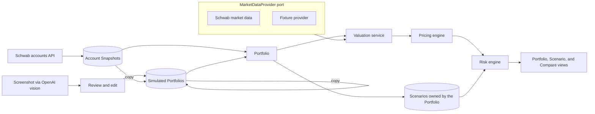

# Portfolio Management and Risk Scenarios

## Domain terms (written to `GLOSSARY.md` when building starts)

- **Account**: one Schwab brokerage account. Its holdings come only from the Schwab API.
- **Snapshot**: an Account's complete holdings at one moment. A Position that's missing from it has been closed. History is kept.
- **Simulated Portfolio**: a named, editable set of Positions with its own cash, owned by no Account. You create it empty, as a copy of another Portfolio, or from a screenshot. A copy is independent from then on.
- **Portfolio**: anything a Scenario runs against, meaning an Account's current Snapshot (read-only) or a Simulated Portfolio.
- **Position**: an instrument with a signed quantity and a signed total cost (a debit is positive, a credit is negative). P/L = market value − total cost.
- **Scenario**: a modeled future for one Portfolio, which owns it. It's a grid of SPY moves by IV shifts, plus days forward and optional per-underlying overrides. Copying a Portfolio copies its Scenarios, and you can copy one Scenario to another Portfolio. Avoid calling it "what-if" or "alternate history".
- **Hypothetical trade**: exists only as a Position in a Simulated Portfolio. There is no temporary overlay on an Account.
- **Loss Threshold**: a risk budget, meaning the largest loss you accept being exposed to under the Portfolio's Scenarios. It's optional for each Portfolio (a dollar amount or a percent of net liquidation value) and for each underlying, and never set on a single leg. It is not an exit rule.
- **Beta-weighted move**: an underlying moves by its beta times the SPY move.

## Architecture

**Pricing and risk are pure TypeScript with no I/O.** Every external dependency sits behind an interface (a "port"), and each concrete integration is an adapter.

- **Instrument identity** is the OCC symbol, or the ticker for equities. Schwab returns OCC symbols, so synced, screenshot, and hand-entered Positions all line up.
- **Total cost from Schwab** is `averagePrice x quantity x multiplier`, because the API has no cost-basis field.
- **We compute IV, greeks, and HV with our own model**, even though Schwab provides its own. The Scenarios have to reprice under shocks with the same model. Schwab's values are kept as a cross-check.
- **The risk engine runs in the browser.** A server function returns the valuation inputs, and the grids recompute instantly as you edit shocks.
- **Stale data:** when the Schwab sign-in has expired, the app shows the last Snapshot and market data with a "data as of" banner and a Reconnect button. Scenarios run on those frozen inputs and are labeled with that time.

## Pricing and risk (`src/domain/`)

- `instruments.ts`: OCC symbols, contract multiplier, and exercise style. SPX, XSP, NDX, and RUT are European; equity and ETF options are American.
- `pricing/bsm.ts`: Black-Scholes-Merton with a continuous dividend yield.
- `pricing/bjerksund.ts`: Bjerksund-Stensland 2002 for American options.
- `pricing/greeks.ts`: closed-form greeks for European options, finite differences for American.
- `pricing/iv.ts`: Brent's method on the mark. It flags marks below intrinsic value.
- `volatility.ts`: HV20 and HV30, close-to-close, annualized.
- `beta.ts`: one-year daily-return regression against SPY.
- `risk/grid.ts`: for each cell, set the price to `S * (1 + beta * move)` (or the override), set IV to the base IV plus the shift (floored), and set time to the remaining time minus days forward. Reprice and sum. Outputs:
  - the P/L matrix
  - the worst cell
  - contributions by underlying and by position
  - risk curves
  - beta-weighted delta
- `risk/thresholds.ts`: which cells breach the Portfolio threshold, and, for each underlying with its own threshold, which cells breach that underlying's threshold.
- `risk/compare.ts`: the difference in P/L, cell by cell, between two Portfolios under the same Scenario.

## Persistence (`src/db/schema/`, sibling modules in the barrel)

- `portfolio.ts`:
  - `account`: Schwab account hash, masked number, last synced time.
  - `portfolio`: kind (`account` or `simulated`), name, cash for simulated Portfolios, and an optional Portfolio Loss Threshold.
  - `snapshot`: holdings, net liquidation value, and cash.
  - `position`: belongs to a Snapshot or to a Simulated Portfolio.
  - `underlying_threshold`: optional threshold for one underlying in a Portfolio.
- `scenario.ts`: Scenario definitions keyed by Portfolio.
- `market-data.ts`: `quote_cache` and `price_history`, each with a fetched-at time for TTL expiry.
- `broker.ts`: `broker_connection` with Schwab tokens encrypted by `TOKEN_ENCRYPTION_KEY`.

## Integrations (server-only)

- `src/server/schwab/`: OAuth (30-minute access token, 7-day refresh token, interactive reconnect), the accounts client, and sync. The callback route is `src/routes/api/schwab/callback.ts`.
- `src/server/market-data/`: the `MarketDataProvider` port, the Schwab adapter, a caching decorator, and a fixture provider.
- `src/server/screenshot/`: the extractor port and an OpenAI adapter using the Responses API with structured output. The model comes from `OPENAI_EXTRACTION_MODEL` ("GPT-6 Luna"). It cross-checks each row (quantity times mark against market value, and total cost against P/L) and flags rows that fail.
- Risk-free rate: a setting with a default for v1.
- `.env.example` adds `OPENAI_API_KEY`, `OPENAI_EXTRACTION_MODEL`, `SCHWAB_CLIENT_ID`, `SCHWAB_CLIENT_SECRET`, `SCHWAB_CALLBACK_URL`, and `TOKEN_ENCRYPTION_KEY`.

## UI (thin routes in `src/routes`, components in `src/components/`)

- `/portfolios`: Accounts and Simulated Portfolios, each with its worst Scenario loss compared with its Portfolio threshold.
- `/portfolios/new`: create a Simulated Portfolio empty, as a copy of a Portfolio, or from a screenshot (then the review table).
- `/portfolios/$portfolioId`:
  - positions grouped by underlying, with position, quantity, total cost, market value, total P/L, greeks, IV, HV20/HV30, and beta
  - totals and beta-weighted delta
  - threshold editors
  - a Sync button and freshness for Accounts, or an edit mode for Simulated Portfolios
- `/portfolios/$portfolioId/scenarios/$scenarioId`: the builder, a heatmap with breach highlighting, the worst cell and contributions, risk curves, and "copy to Portfolio".
- `/compare`: one Scenario on two Portfolios, with both grids and the difference.
- `/settings/connections`: connect or reconnect Schwab and show the token status.

## Testing (layers from `tests/AGENTS.md`)

- Unit tests:
  - pricing against Haug's reference values
  - IV round trip
  - OCC parsing
  - HV and beta on fixed price series
  - the grid, thresholds, and compare on a hand-checked portfolio, including a put spread that breaches its underlying threshold only as a whole
- Component tests: editing the review table, and breach colors on the heatmap.
- Service tests: a Snapshot is written only when holdings change, a Portfolio copy also copies its Scenarios, and the current-Snapshot query.
- External tests: MSW stubs for Schwab accounts, quotes, chains, history, and token refresh, and for the OpenAI response.
- Playwright: the flow in the `e2e` todo.

## Roadmap

- **v2: Position rules from history.** An agentic flow that analyzes historical data (Snapshot history plus price history) and proposes rules for holding, adding to, or trimming positions, which you tune with a prompt. Details get worked out when it comes into planning. Keeping Snapshot history in v1 makes this possible.
- Strategy detection (verticals, condors, calendars).
- Monte Carlo paths and VaR on the same pricing engine.
- Correlated shocks and volatility skew instead of flat IV shifts.
- A combined view across Accounts.
- Futures, futures options, and mutual funds (the Schwab API doesn't return them).

## Risks

- Schwab approval takes 1 to 3 days. The fixture provider and screenshot-built Simulated Portfolios keep work moving in the meantime.
- Signing in again every week is unavoidable. The stale banner keeps it visible rather than failing silently.
- Flat IV shifts understate crash risk. Skew is on the roadmap.
- The vision model can misread a digit, which the cross-checks and the mandatory review step guard against.
