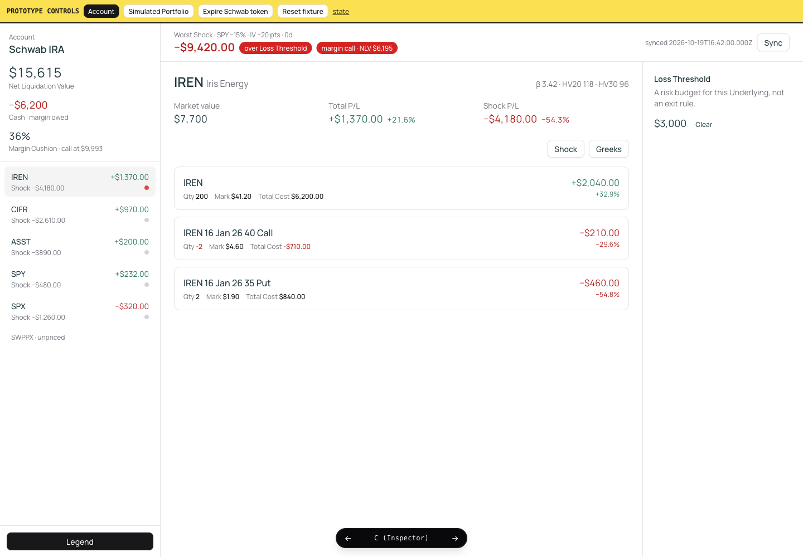
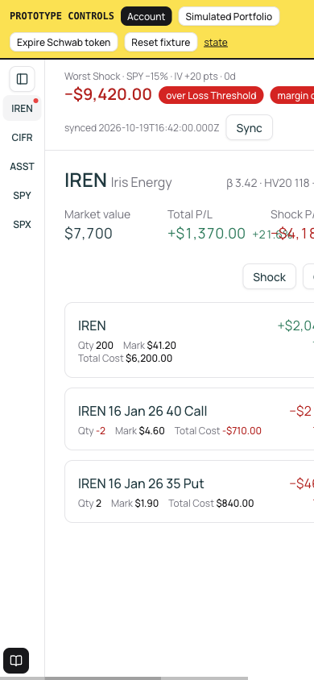

# What should the Portfolio view look like?

Type: prototype
Status: resolved
Blocked by: 13

## Question

Build rough UI variations of the Portfolio page with fixture data and react to them:

- the dense metrics table (instrument, quantity, Total Cost, market value, total P/L, greeks, IV, HV20/HV30, beta), grouped by Underlying with subtotals
- the worst Scenario loss against the Portfolio Loss Threshold, and where Underlying thresholds are set and shown
- freshness and Sync for an Account; edit mode, cash, and adding a Hypothetical Trade for a Simulated Portfolio
- how you add a Position by hand (symbol search plus an option chain picker, or typing a contract)

## Comments

**2026-10-19, prototype ready for reaction (not the answer yet):**

Throwaway route on the real stack: [http://localhost:3000/prototype/portfolio](http://localhost:3000/prototype/portfolio) (`pnpm prototype:portfolio` or the running `pnpm dev`). Switch variants with the bottom bar or `?variant=A|B|C`. The yellow strip is prototype-only: Account vs Simulated Portfolio, expire token, dump state.

- **A (Blotter):** thinkorswim-style dense table. Type an OCC-like contract to add a Position.
- **B (Risk cards):** worst Shock as a hero against the Loss Threshold, then one card per Underlying. Add via an IREN chain picker.
- **C (Inspector):** left rail of Underlyings, detail in the middle, Loss Threshold editor on the right. Add via ⌘K.

Fixture is a Schwab IRA (IREN / CIFR / ASST stock picks, SPY, an SPX put, unpriced SWPPX) and a Simulated Portfolio copy with a Hypothetical Trade. This ticket stays open until a variant (or mix) wins.

**2026-10-19, reaction:** Inspector (C) is the one to keep. Two additions, now on that variant:

- Under Net Liquidation Value: Cash (positive is money on hand, negative is margin owed) and Margin Cushion (percent of room before a margin call; absent when not borrowing). The fixture Account is borrowing, so both show.
- Greeks stay off the Position until its Greeks button is pressed. The button sits on the Position in the detail, because a greek belongs to one contract. The click in the recording was on the IREN row in the picker.

**2026-10-19, second reaction, still open:**

- Clicking Greeks on any Position shows them on every Position, so they can be compared. Clicking again hides them all.
- A Legend button floats at the bottom left and defines the greek symbols, beta, HV, and Margin Cushion.
- Margin Cushion means the percent Net Liquidation Value can fall before a margin call, and the rail shows the dollar level of that call. The 36% is still a fixture, not a Schwab maintenance calculation. The worst Shock is flagged when the shocked Net Liquidation Value is at or under that level.

**2026-10-19, layout:** A negative amount stays on one line with its sign. When the detail pane is narrow, the amount sits above the Greeks button. The detail pane has a minimum width, and the page scrolls sideways instead of crushing that pane. Below a wide window the holdings pane collapses to symbols; a control at its top slides the full pane out over the page.

**2026-10-19, detail:** One Greeks button sits under the Underlying header and reveals every option on the page. Qty, Mark, and Total Cost use a muted label and a darker value; a negative quantity or Total Cost is red. Each Position's P/L also shows the percent since it was opened, next to the dollars.

**2026-10-19, loss threshold:** The $2,000 control is a stub. The budget you set is a percent of the whole account. When a Scenario's Shock crosses it, you can choose to start a risk-reduction pass. In v1 that pass opens a Simulated Portfolio and the Compare view. In v2 it is an agentic guided loop. Nothing trades on its own. Per-Underlying dollar budgets are not the primary control. The controls and values that pass adjusts are one function each, exposed on the page as WebMCP tools and headlessly through one MCP endpoint at the Tailscale address. Tools return rich data and the agent draws conclusions. Tool names are not chosen yet. See `docs/adr/0005-scenario-controls-are-webmcp-tools.md`.

**2026-10-19, shock percent and legend:** Shock P/L shows a percent beside the dollars, the shock divided by that Underlying's market value. The Legend button sits at the bottom of the holdings pane.

**2026-10-19, shock on each Position:** A Shock toggle sits beside Greeks above the contracts. On, each Position's P/L is that header Shock's P/L. Off, it is open P/L. The Underlying Shock P/L stays the subtotal.

## Answer

Settled 2026-10-19. Inspector (variant C) is the Portfolio view.

The throwaway route stays at `/prototype/portfolio?variant=C` until the real page is built. Variants A and B lost.

**Panes**

- Left: the Portfolio. Net Liquidation Value, Cash (positive is money on hand, negative is margin owed), and Margin Cushion. When borrowing, the cushion shows the dollar call level, today's Net Liquidation Value times one minus the percent. A name that is not borrowing has no cushion. Underlyings list open P/L and that name's Shock P/L, with a dot when the name is over its threshold. An asset the app cannot price is listed and labeled unpriced. The Legend sits at the bottom of this pane. Below a wide window the pane collapses to symbols, and a control slides the full pane out over the page.
- Middle: the worst Shock of the Portfolio's Scenarios. The line names the Shock and shows its P/L. It flags the Portfolio when that loss is over the account's Loss Threshold, and when the shocked Net Liquidation Value is at or under the margin-call level. The selected Underlying shows market value, Total P/L (dollars and the percent since open), and Shock P/L (dollars and the percent of that Underlying's market value), plus beta, HV20, and HV30. Each Position shows quantity, mark, and Total Cost: a muted label, a darker value, and red when the quantity or Total Cost is negative. A negative amount stays on one line with its sign. The detail pane has a minimum width and the page scrolls sideways instead of crushing it.
- Right: the selected Underlying's Loss Threshold, shown in dollars, with a way to clear it. The budget you set for the account is a percent of Net Liquidation Value, judged in the header. The prototype's "Set $2,000" button is a stub, not that editor. A per-Underlying dollar budget is optional and is not the primary control.

**Shock on the rows**

The header Shock is the only Shock this page applies. A Shock toggle sits beside Greeks, above the contracts. On, every Position's P/L becomes that Shock's P/L, dollars and the percent of that Position's market value, and those rows add up to the Underlying's Shock P/L. Off, the rows show open P/L. Greeks is one button for every option on the page. Choosing a different Shock, and seeing the grid, is the Scenario view.

**Freshness and editing**

An Account shows when it last synced, and Sync. When the Schwab token has lapsed, it shows data-as-of and Reconnect. A Simulated Portfolio can be edited, including its Cash, and a Position is added with ⌘K from the option chain. A Position added by hand is a Hypothetical Trade. Typing a contract, the blotter's method, lost.

**What a breach starts**

Crossing the account percent opens a Simulated Portfolio and the Compare view in v1. The guided loop is v2. Nothing on this page places an order. The controls are the ones in `docs/adr/0005-scenario-controls-are-webmcp-tools.md`.

